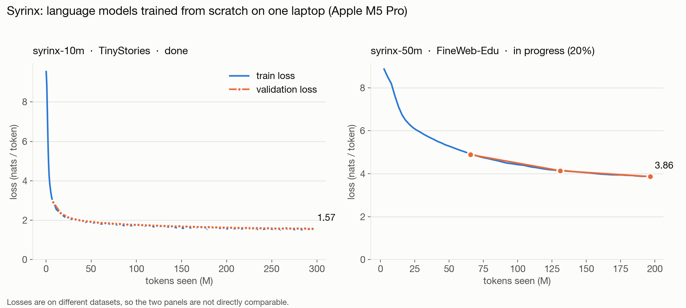

# Syrinx

A GPT-style decoder-only language model built from scratch in PyTorch: RMSNorm, RoPE, SwiGLU,
causal multi-head attention, tied embeddings, a 32K byte-level BPE tokenizer, and context 1024.
It is scaled 10M → 50M → 125M parameters on a single laptop (Apple M5 Pro, PyTorch MPS) and
released as a checkpoint that loads with `LlamaForCausalLM`, no custom code needed.

## Status

| Model | Data | Status |
|---|---|---|
| [syrinx-10m](https://huggingface.co/DhruvParmar051/syrinx-10m) | TinyStories, 295M tokens | **Released** on Hugging Face |
| syrinx-50m | FineWeb-Edu, 1.0B tokens | Training (step 750 of 3,815) |
| syrinx-125m | FineWeb-Edu, 2.5B tokens | Next |



The two panels use different datasets, so their losses are not comparable with each other.

## syrinx-10m

11,798,784 parameters, trained for 9,000 steps (294,912,000 tokens) in 2.48 h on the laptop GPU.
Full model card: [`docs/model-cards/syrinx-10m.md`](docs/model-cards/syrinx-10m.md).

| Full-split validation (TinyStories) | |
|---|---|
| Loss | 1.5641 nats/token |
| Perplexity | 4.78 |
| Bits per byte | 0.5769 |
| HF export parity (max abs logit diff) | 0.0 |

Benchmarks (0-shot, lm-evaluation-harness) are close to chance, as expected for a 10M model trained
only on children's stories; the card reports them with contaminated examples split out.

```python
import torch
from transformers import AutoModelForCausalLM, AutoTokenizer

tok = AutoTokenizer.from_pretrained("DhruvParmar051/syrinx-10m")
model = AutoModelForCausalLM.from_pretrained("DhruvParmar051/syrinx-10m", dtype=torch.float32)
ids = tok(tok.bos_token + "Once upon a time", return_tensors="pt")
print(tok.decode(model.generate(**ids, max_new_tokens=100)[0], skip_special_tokens=True))
```

Needs `transformers>=5.17`. Start prompts with `tok.bos_token`: every training document followed it.

## Setup
```bash
uv sync --all-extras          # core + export (transformers) + eval (lm-eval) + dev
uv run pytest -q              # run tests (MPS if available)
SYRINX_DEVICE=cpu uv run pytest -q   # force CPU
```

## Layout
- [`PLAN.md`](PLAN.md): phases, gates, compute budget, runbook
- [`docs/decisions.md`](docs/decisions.md): design decisions and why
- [`docs/data.md`](docs/data.md): data sources, licenses, pipeline rules
- [`docs/reference/config-spec.md`](docs/reference/config-spec.md): config and parameter-count spec
- [`docs/model-cards/`](docs/model-cards/): model cards, written from logged evidence only
- [`experiments/log.md`](experiments/log.md): every run, with numbers traced to log files

## License
Apache-2.0. See [LICENSE](LICENSE).
